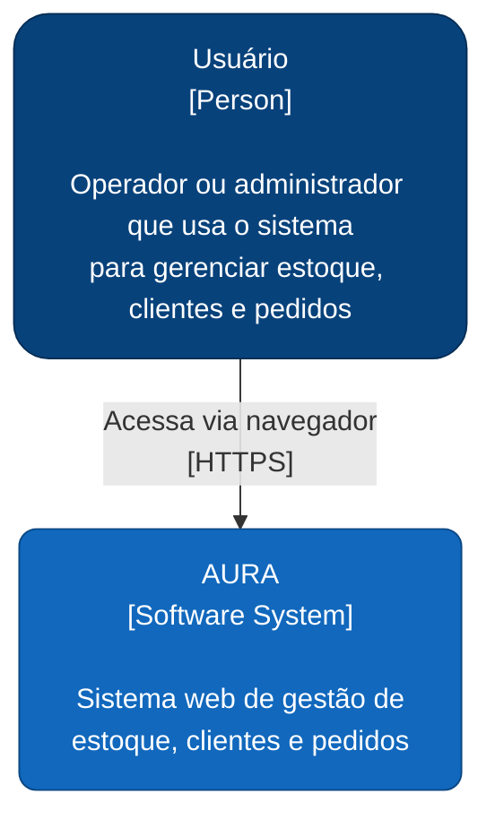
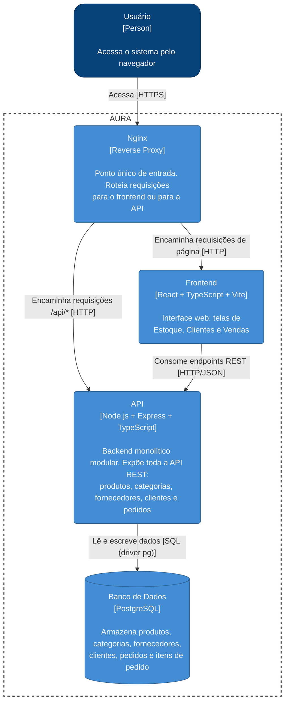
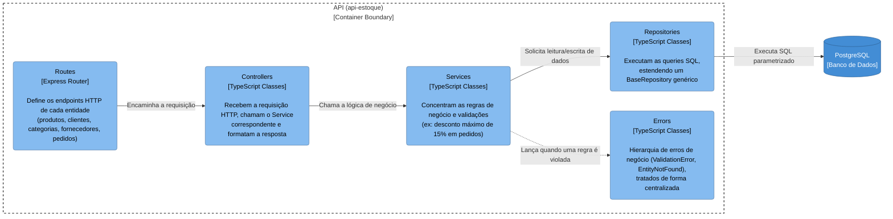

# Arquitetura do Sistema

Documentação sobre a atual arquitetura ao final da Sprint 3, usando modelo C4.

## 1. Visão de Contexto

Mostra o sistema como uma caixa única, e quem interage com ele de fora.

**Leitura do diagrama:** hoje o sistema tem um único tipo de ator externo, o **Usuário**, que
acessa tudo pelo navegador. Não há integração com sistemas de terceiros, serviços de e-mail,
gateways de pagamento ou qualquer outro ator externo nesta fase do projeto.

## 2. Visão de Contêineres

Mostra as peças de software que compõem o sistema e como elas se comunicam.

### Responsabilidades de cada contêiner

- **Nginx**: único ponto de entrada do sistema. Roteia o tráfego de página (`/`) para o
  frontend e o tráfego de API para o backend, seguindo o padrão de API Gateway
  definido na ADR de arquitetura geral.
- **Frontend (web)**: aplicação React/TypeScript construída com Vite. Contém as páginas de
  Estoque, Clientes e Vendas, todas seguindo o mesmo padrão de componentes (Table, Modal,
  Form) e consumindo a API via `fetch`.
- **API**: aplicação em TypeScript. Diferente do que a ADR de arquitetura geral
  previa inicialmente, a API é hoje **um único contêiner**, que
  concentra todas as entidades do domínio,
  organizadas internamente em camadas.
- **Banco de Dados**: PostgreSQL, acessado diretamente via driver `pg` (sem ORM), com queries
  SQL parametrizadas escritas nos repositories.

## 3. Visão de Componentes (dentro da API)

A API é organizada em camadas, seguindo o padrão **Controller → Service → Repository**, repetido
para cada entidade do domínio.

### Responsabilidades de cada camada

- **Routes**: só define qual método HTTP e caminho chama qual método do Controller. Não contém
  lógica.
- **Controllers**: traduzem a requisição HTTP (`req`/`res`) em uma chamada ao Service, e
  devolvem a resposta já no formato padronizado `createSuccessBodyResponse` ou tratam o erro `handleError`.
- **Services**: onde moram as regras de negócio: validações de campos obrigatórios, conferência
  de relacionamentos e regras específicas
  do domínio, como o limite de desconto de 15% no cadastro de itens de pedido.
- **Repositories**: isolam o acesso ao banco. Todos estendem `BaseRepository<T>`, que fornece
  `findAll`, `findById`, `insert`, `update` e `delete` genéricos. Repositories específicos adicionam métodos próprios quando necessário, incluindo o uso de
  transações para operações que envolvem mais de uma tabela.
- **Errors**: uma pequena hierarquia (`AppError` → `ValidationError`, `EntityNotFound`) que
  permite ao `handleError` decidir automaticamente o status HTTP correto, sem cada Controller
  precisar repetir essa lógica.

## 4. Como a arquitetura apoia o MVP

- O **Nginx como ponto único de entrada** simplifica o consumo da API pelo frontend e facilita evoluções futuras sem mexer no código das aplicações.
- A **camada de Services centralizando as regras de negócio** garante que a regra seja aplicada de forma consistente, independentemente de qual
  Controller ou rota a chamou e protege contra um usuário tentando burlar a validação do
  frontend, já que o backend sempre revalida.
- O **padrão repetido em todas as entidades** reduz a curva de aprendizado para qualquer integrante mexer em uma
  entidade nova: quem já entendeu `Produto` entende `Pedido` com o mesmo raciocínio.

## 5. Diferenças entre o planejado e o implementado

| Planejado (ADR de arquitetura geral) | Implementado hoje |
|---|---|
| Arquitetura de microsserviços, com múltiplos serviços independentes atrás do Nginx | Um único backend monolítico modular, cobrindo todas as entidades |

**Justificativa da divergência:** a equipe optou por consolidar o backend em um único contêiner
modular para reduzir a complexidade de infraestrutura e de
comunicação entre serviços neste estágio do projeto, mantendo ainda assim uma separação clara de responsabilidades dentro do código, o que preserva apossibilidade de 
extrair módulos para serviços independentes no futuro, caso necessário.