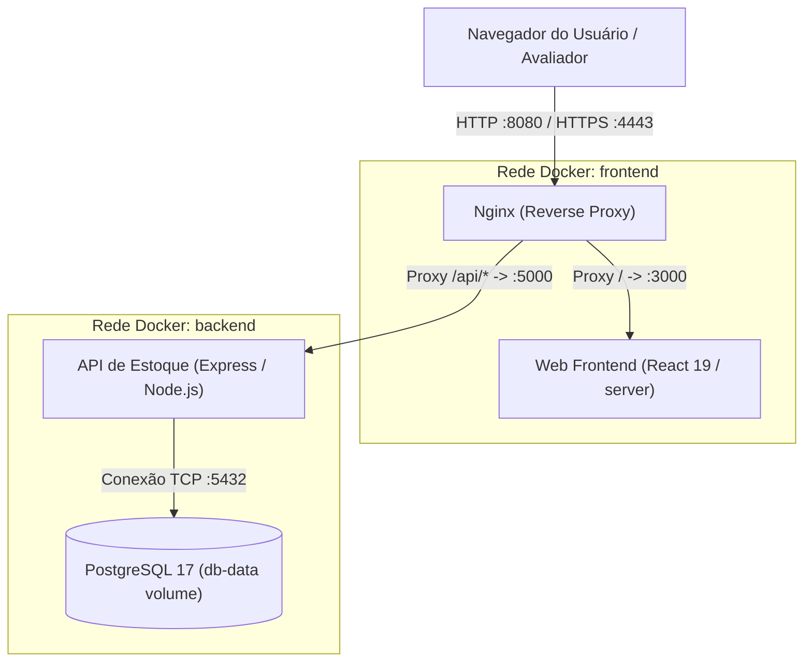

# Guia de Deploy e Execução da Aplicação (Staging & Local)

Documento de especificação de deploy, execução e homologação da aplicação **AURA ERP**, referente à entrega da Sprint 4 (Entrega 8).

---

## 1. Visão Geral da Arquitetura de Implantação

O **AURA ERP** é implantado utilizando uma arquitetura conteinerizada orquestrada por **Docker Compose**, composta por 4 serviços interdependentes conectados por duas redes internas isoladas (`frontend` e `backend`):



### Componentes da Infraestrutura:

1. **Nginx (`nginx:1.27-alpine`):**
   - Atua como **Reverse Proxy / API Gateway** e único ponto de entrada público do sistema.
   - Escuta na porta `8080` (HTTP) e `4443` (HTTPS) da máquina host.
   - Encaminha requisições da raiz (`/`) para o contêiner `web` e requisições iniciadas em `/api/` para o contêiner `api-estoque`.
   - Gera logs de acesso e erros mapeados no diretório do host `./logs/nginx`.

2. **Frontend Web (`web`):**
   - SPA desenvolvida em React 19, TypeScript e empacotada com Vite.
   - **Em produção / staging:** Utiliza build multi-stage (`frontend/Dockerfile`). O estágio 1 compila os artefatos estáticos (`npm run build` gerando `dist/`), e o estágio 2 executa o servidor otimizado `serve` servindo os arquivos estáticos na porta interna `${PORT_WEB}` (3000). Roda como usuário sem privilégios de root (`USER node`).
   - **Em desenvolvimento:** Utiliza `frontend/Dockerfile.dev` com servidor de desenvolvimento do Vite e `docker compose watch` sincronizando arquivos em tempo real.

3. **API de Estoque (`api-estoque`):**
   - Backend monolítico modular em Node.js 24, Express e TypeScript.
   - **Em produção / staging:** Utiliza build multi-stage (`api-estoque/Dockerfile`). O estágio 1 compila o TypeScript (`npm run build`), e o estágio 2 instala apenas as dependências de produção (`npm ci --omit=dev`), rodando o código transpilado em `dist/server.js` na porta interna `${PORT_API_ESTOQUE}` (5000) com usuário `node`.
   - **Em desenvolvimento:** Utiliza `api-estoque/Dockerfile.dev` com `tsx watch` e sincronização de código via `docker compose watch`.
   - Registra logs estruturados com Winston na pasta mapeada `./logs/api-estoque`.

4. **Banco de Dados (`db`):**
   - Instância de **PostgreSQL 17 Alpine**.
   - Persistência garantida através de volume nomeado `db-data`.
   - Inicialização e carga de dados semente (seed) automática via script montado em `/docker-entrypoint-initdb.d/init.sql` a partir de `conf/init-db.sql`.

---

## 2. Pré-requisitos do Sistema

Para realizar o build, deploy e validação da aplicação, o ambiente host deve atender aos requisitos abaixo:

### 2.1. Ferramental Obrigatório

| Ferramenta         | Versão Mínima Recomendada                                 | Finalidade                                      |
| ------------------ | --------------------------------------------------------- | ----------------------------------------------- |
| **Docker Engine**  | `24.0.0+` (ou Docker Desktop `4.20.0+`)                   | Execução dos contêineres de serviço             |
| **Docker Compose** | `v2.20.0+` (integrado ao Docker CLI via `docker compose`) | Orquestração dos múltiplos contêineres          |
| **GNU Make**       | `4.0+`                                                    | Execução simplificada dos comandos via Makefile |
| **Git**            | `2.30+`                                                   | Clonagem do repositório e controle de versão    |

> [!NOTE]
> Usuários Windows podem executar os comandos do `Makefile` através do WSL2 (Windows Subsystem for Linux), Git Bash ou instalando o utilitário Make via Chocolatey (`choco install make`). Caso prefira, todos os comandos do Makefile possuem seus equivalentes diretos via `docker compose` descritos neste documento.

### 2.2. Ferramental Opcional (apenas para testes locais ou execução sem Docker)

| Ferramenta  | Versão Recomendada | Finalidade                                          |
| ----------- | ------------------ | --------------------------------------------------- |
| **Node.js** | `v24.x LTS`        | Execução direta de scripts, testes e linter no host |
| **npm**     | `v10.x+`           | Gerenciador de dependências dos projetos Node.js    |

### 2.3. Portas de Rede Necessárias

As seguintes portas devem estar livres na máquina hospedeira antes de subir os contêineres:

| Porta Host | Protocolo | Serviço     | Descrição                                               |
| ---------- | --------- | ----------- | ------------------------------------------------------- |
| **`8080`** | TCP/HTTP  | Nginx Proxy | Ponto de entrada padrão para acessar o Frontend e a API |
| **`4443`** | TCP/HTTPS | Nginx Proxy | Ponto de entrada seguro do proxy reverso                |

### 2.4. Recursos Mínimos de Hardware

- **Processador:** 2 cores (x86_64 ou ARM64)
- **Memória RAM:** 4 GB livre
- **Espaço em Disco:** 5 GB livre para imagens Docker, dependências e volume de dados

---

## 3. Variáveis de Ambiente e Configuração

A configuração de todos os serviços do sistema é centralizada em um **arquivo `.env` único** localizado na raiz do projeto.

### 3.1. Como Criar o Arquivo de Configuração

Ao clonar o repositório pela primeira vez, crie o arquivo `.env` a partir do template padrão `.env.example`:

```bash
cp .env.example .env
```

### 3.2. Dicionário das Variáveis de Ambiente

| Variável           | Descrição                                   | Valor Padrão (`.env.example`) | Obrigatória | Recomendações de Segurança e Produção                                                                                             |
| ------------------ | ------------------------------------------- | ----------------------------- | :---------: | --------------------------------------------------------------------------------------------------------------------------------- |
| `PORT_WEB`         | Porta do servidor frontend web internamente | `3000`                        |     Sim     | Manter `3000` para alinhamento com a configuração do Nginx template.                                                              |
| `PORT_API_ESTOQUE` | Porta da API de Estoque internamente        | `5000`                        |     Sim     | Manter `5000` para alinhamento com a rota upstream do Nginx template.                                                             |
| `DB_HOST`          | Host para conexão com o banco de dados      | `db`                          |     Sim     | Em ambiente Docker Compose, deve ser obrigatoriamente `db` (nome do serviço). Para execução sem Docker no host, usar `localhost`. |
| `DB_PORT`          | Porta de rede do PostgreSQL                 | `5432`                        |     Sim     | Porta padrão do PostgreSQL.                                                                                                       |
| `DB_USER`          | Usuário administrador do PostgreSQL         | `postgres`                    |     Sim     | Em ambiente de homologação/produção real, defina um usuário específico e não utilize usuários padrão.                             |
| `DB_PASSWORD`      | Senha de autenticação do PostgreSQL         | `changeme`                    |     Sim     | **Alterar obrigatoriamente** para uma senha forte em ambientes fora de desenvolvimento local.                                     |
| `DB_NAME`          | Nome da base de dados da aplicação          | `estoque`                     |     Sim     | Base criada automaticamente pelo contêiner do Postgres.                                                                           |
| `NODE_ENV`         | Modo de operação do ambiente Node.js        | `development`                 |     Sim     | Em produção / staging conteinerizado, os Dockerfiles definem internamente `production`, garantindo otimização de dependências.    |

> [!CAUTION]
> **Segurança de Credenciais:** O arquivo `.env` contém credenciais e jamais deve ser versionado no Git. Ele está registrado no arquivo `.gitignore`. Nunca altere o `.env.example` com senhas reais de ambientes públicos.

---

## 4. Comandos de Build, Execução e Gerenciamento

O projeto disponibiliza um `Makefile` na raiz com atalhos para os fluxos operacionais, abstraindo comandos longos do `docker compose`.

### 4.1. Tabela Comparativa de Comandos

| Finalidade                        | Comando Makefile  | Comando Docker Compose Equivalente                                                    |
| --------------------------------- | ----------------- | ------------------------------------------------------------------------------------- |
| **Deploy / Subir Staging (Prod)** | `make prod`       | `docker compose -f docker-compose.yaml -f docker-compose.prod.yaml up -d --build`     |
| **Build de Produção (sem cache)** | `make build-prod` | `docker compose -f docker-compose.yaml -f docker-compose.prod.yaml build --no-cache`  |
| **Derrubar Ambiente Staging**     | `make down-prod`  | `docker compose -f docker-compose.yaml -f docker-compose.prod.yaml down`              |
| **Ver Logs de Staging**           | `make logs-prod`  | `docker compose -f docker-compose.yaml -f docker-compose.prod.yaml logs -f`           |
| **Subir Desenvolvimento (Watch)** | `make dev`        | `docker compose -f docker-compose.yaml -f docker-compose.dev.yaml up --build --watch` |
| **Build de Desenvolvimento**      | `make build-dev`  | `docker compose -f docker-compose.yaml -f docker-compose.dev.yaml build --no-cache`   |
| **Derrubar Desenvolvimento**      | `make down-dev`   | `docker compose -f docker-compose.yaml -f docker-compose.dev.yaml down`               |
| **Ver Logs de Desenvolvimento**   | `make logs-dev`   | `docker compose -f docker-compose.yaml -f docker-compose.dev.yaml logs -f`            |
| **Executar Testes Unitários**     | `make test`       | `cd api-estoque && npx vitest run && cd ../frontend && npx vitest run`                |
| **Executar Linter (ESLint)**      | `make lint`       | `cd api-estoque && npm run lint && cd ../frontend && npm run lint`                    |
| **Formatar Código (Prettier)**    | `make format`     | `cd api-estoque && npm run format && cd ../frontend && npm run format`                |

---

## 5. Processo de Deploy Passo a Passo (Staging Reprodutível)

Como o projeto não utiliza um provedor de nuvem contratado no contexto acadêmico, o **ambiente de staging** é implementado como uma **réplica de produção local conteinerizada e totalmente reprodutível**.

Siga o roteiro abaixo para realizar o deploy completo a partir de um checkout limpo:

### Passo 1: Clonar o Repositório e Navegar até a Raiz

```bash
git clone https://github.com/IFSC-ES2/es2-2026_2-equipe-2.git
cd es2-2026_2-equipe-2
```

Se for validar uma release específica (exemplo: `v0.4.0`), faça o checkout da tag:

```bash
git checkout v0.4.0
```

### Passo 2: Configurar as Variáveis de Ambiente

Crie o arquivo `.env` copiando o modelo:

```bash
cp .env.example .env
```

_(Opcional)_ Edite o arquivo `.env` com seu editor preferido para ajustar portas ou senhas, caso necessário. Os valores padrão fornecidos em `.env.example` já estão pré-configurados para funcionar imediatamente.

### Passo 3: Executar o Build e Subir os Contêineres de Produção

Execute o comando de deploy de produção:

```bash
make prod
```

O comando executará as seguintes operações:

1. Compilará as imagens Docker de `web` e `api-estoque` em estágios múltiplos sem pacotes de desenvolvimento;
2. Criará o volume `db-data` e executará o script `conf/init-db.sql` populando o banco de dados com a seed inicial;
3. Iniciará os 4 serviços (`db`, `api-estoque`, `web` e `nginx`) em segundo plano (`-d`);
4. Aplicará políticas de reinicialização automática (`restart: unless-stopped`) nos serviços essenciais.

### Passo 4: Acompanhar os Logs de Inicialização

Acompanhe o log unificado dos contêineres até que todos os healthchecks estejam saudáveis:

```bash
make logs-prod
```

Para sair da visualização de logs, pressione `Ctrl + C` (os contêineres continuarão rodando em segundo plano).

---

## 6. Passo a Passo para Validar o Ambiente (Smoke Tests & Healthchecks)

Após o comando de deploy, execute a validação sistemática do ambiente implantado.

### 6.1. Verificação do Status dos Contêineres (Docker Healthchecks)

Verifique o estado dos contêineres executando:

```bash
docker compose -f docker-compose.yaml -f docker-compose.prod.yaml ps
```

**Saída esperada:** Todos os 4 contêineres devem exibir o status `Up` e `(healthy)`:

```text
NAME                                  STATUS                    PORTS
es2-2026_2-equipe-2-db-1              Up (healthy)              5432/tcp
es2-2026_2-equipe-2-api-estoque-1     Up (healthy)              0.0.0.0:5000->5000/tcp
es2-2026_2-equipe-2-web-1             Up (healthy)              0.0.0.0:3000->3000/tcp
es2-2026_2-equipe-2-nginx-1           Up (healthy)              0.0.0.0:8080->80/tcp, 0.0.0.0:4443->443/tcp
```

### 6.2. Matriz de Validação de Endpoints e URLs

Abra o navegador ou use utilitários como `curl` para validar as seguintes rotas:

| Serviço                     | URL de Acesso                                                            | Método HTTP | Status Esperado | O que deve ser exibido / validado                                                                  |
| --------------------------- | ------------------------------------------------------------------------ | :---------: | :-------------: | -------------------------------------------------------------------------------------------------- |
| **Frontend Web**            | [http://localhost:8080](http://localhost:8080)                           |    `GET`    |    `200 OK`     | Interface gráfica do AURA ERP carregada com Sidebar, cabeçalho e páginas acessíveis.               |
| **Healthcheck API**         | [http://localhost:8080/api/ping](http://localhost:8080/api/ping)         |    `GET`    |    `200 OK`     | Resposta textual `pong`, indicando que a API Express está viva e roteada pelo Nginx.               |
| **Documentação Swagger**    | [http://localhost:8080/api/docs](http://localhost:8080/api/docs)         |    `GET`    |    `200 OK`     | Interface interativa Swagger UI listando os endpoints de produtos, clientes, categorias e pedidos. |
| **API - Listagem Produtos** | [http://localhost:8080/api/produtos](http://localhost:8080/api/produtos) |    `GET`    |    `200 OK`     | JSON contendo a lista inicial de produtos carregados pelo seed SQL.                                |
| **API - Listagem Clientes** | [http://localhost:8080/api/clientes](http://localhost:8080/api/clientes) |    `GET`    |    `200 OK`     | JSON contendo a lista inicial de clientes cadastrados.                                             |
| **API - Listagem Pedidos**  | [http://localhost:8080/api/pedidos](http://localhost:8080/api/pedidos)   |    `GET`    |    `200 OK`     | JSON com a lista de pedidos e itens associados.                                                    |

#### Validação Rápida via Linha de Comando (cURL):

```bash
# Validar API através do proxy Nginx
curl -i http://localhost:8080/api/ping

# Validar Frontend através do proxy Nginx
curl -i http://localhost:8080/

# Validar resposta JSON de produtos
curl -s http://localhost:8080/api/produtos | grep -q "Smartphone" && echo "API de produtos OK"
```

### 6.3. Roteiro de Teste Funcional Integrado (Smoke Test Operacional)

Para validar o fluxo funcional de ponta a ponta na interface gráfica:

1. **Acessar a Aplicação:** Abra `http://localhost:8080` no navegador.
2. **Navegar para a Tela de Estoque (`/estoque`):**
   - Verifique se a tabela exibe os produtos vindos do seed (ex.: _Smartphone XPTO_, _Notebook Ultra_).
   - Clique em **"Cadastrar Produto"**, preencha os dados (nome, SKU único, categoria, fornecedor, quantidade e preço) e salve.
   - Confirme se o novo produto aparece imediatamente na listagem.
3. **Navegar para a Tela de Clientes (`/clientes`):**
   - Verifique os clientes semente (ex.: _Maria Silva_, _João Pereira_).
   - Clique em **"Cadastrar Cliente"**, informe nome, e-mail, telefone e documento válido e salve.
4. **Navegar para a Tela de Vendas (`/vendas`):**
   - Observe a lista de pedidos existentes e o gráfico de evolução de vendas.
   - Clique em **"Novo Pedido"**.
   - Selecione o cliente criado e adicione um produto informando uma quantidade menor ou igual ao estoque existente.
   - Finalize o pedido e verifique se o pedido aparece na tabela de vendas.
5. **Validar a Baixa Automática no Estoque:**
   - Retorne à tela de **Estoque** (`/estoque`).
   - Confirme que a quantidade em estoque do produto vendido diminuiu exatamente no montante do item vendido no pedido (regra de negócio da Sprint 4).
6. **Inspeção de Logs Gerados:**
   - Verifique que as requisições geraram logs em `./logs/nginx/access.log` e `./logs/api-estoque/`.

---

## 7. Como Rodar Localmente

Existem duas formas principais de executar o projeto localmente para fins de desenvolvimento ou testes.

### 7.1. Modo Recomendado: Desenvolvimento com Docker e Hot-Reload (`make dev`)

Este modo utiliza `docker compose watch`, que monitora o sistema de arquivos host e sincroniza o código automaticamente com o interior dos contêineres sem necessidade de reconstruir as imagens a cada alteração.

1. Garanta que o arquivo `.env` existe:
   ```bash
   cp .env.example .env
   ```
2. Inicie o ambiente de desenvolvimento:
   ```bash
   make dev
   ```
3. O terminal permanecerá em modo de acompanhamento (_watch_). Qualquer alteração feita nos arquivos em `frontend/src` ou `api-estoque/src` será refletida instantaneamente (Hot Module Replacement no frontend e reinicialização automática via `tsx watch` na API).
4. Para encerrar o ambiente: pressione `Ctrl + C` e execute:
   ```bash
   make down-dev
   ```

### 7.2. Modo Bare-Metal (Execução sem Docker no Host)

Caso necessite rodar os serviços diretamente na máquina para depuração específica sem Docker:

1. **Banco de Dados PostgreSQL:**
   - Certifique-se de que o PostgreSQL está rodando localmente na porta `5432`.
   - Crie o banco `estoque`: `createdb estoque`.
   - Importe a estrutura e os dados iniciais: `psql -U postgres -d estoque -f conf/init-db.sql`.
2. **Configurar `.env`:**
   - Configure `DB_HOST=localhost` no `.env`.
3. **Iniciar a API Backend:**
   ```bash
   cd api-estoque
   npm install
   npm run dev
   ```
   A API responderá na porta configurada (padrão `5000`).
4. **Iniciar o Frontend Web:**
   ```bash
   cd frontend
   npm install
   npm run dev
   ```
   O Vite responderá na porta configurada (padrão `3000`).

---

## 8. Limitações Conhecidas do Staging

De acordo com o planejamento e o escopo acordado da Sprint 4 (Entrega 8), o ambiente de homologação/staging possui as seguintes características e limitações conhecidas:

1. **Infraestrutura Local Conteinerizada vs. Nuvem Dedicada:**
   O projeto não possui provisionamento em servidores de nuvem paga (AWS, Azure ou GCP) devido ao escopo estritamente acadêmico da disciplina. O ambiente de staging é, portanto, uma réplica conteinerizada isolada executável localmente via `make prod`.
2. **Certificados TLS/SSL:**
   O proxy Nginx mapeia a porta `4443`, porém opera com configuração padrão HTTP sobre a porta `8080`, não possuindo certificados criptográficos assinados por autoridade certificadora (CA) válida.
3. **Ausência de Módulo de Autenticação/Autorização (RBAC):**
   O MVP atual não inclui login de usuários, controle de sessão ou permissões de acesso baseadas em papéis. Todos os endpoints da API e telas são de acesso público na rede local onde os contêineres estão ativos.
4. **CORS Aberto na API:**
   A API Express utiliza o middleware `cors()` de forma permissiva para garantir que diferentes portas e hosts de teste consigam consumir os endpoints sem bloqueio de origem cruzada.
5. **Persistência de Dados e Ciclo de Vida do Volume:**
   Os dados do banco residem no volume Docker nomeado `db-data`. As alterações persistem normalmente entre comandos `make down-prod` e `make prod`. Entretanto, se for executado `docker compose down -v` (com remoção de volumes), os dados acumulados serão apagados e o banco será reiniciado com a semente original do `conf/init-db.sql`.
6. **Pipeline de CD (Continuous Deployment) Não Automatizado:**
   O repositório possui integração contínua (CI via GitHub Actions) para verificação de branches, linter, builds e testes, mas não realiza deploy contínuo automatizado em servidor externo devido à ausência de infraestrutura remota contratada.

---

## 9. Solução de Problemas Comuns (Troubleshooting)

### Erro: `bind: address already in use`

- **Causa:** Uma das portas (`8080`, `3000`, `5000` ou `5432`) já está sendo utilizada por outro processo na máquina host (exemplo: uma instância local do PostgreSQL ou Apache/Nginx).
- **Solução:** Identifique e pare o serviço conflitante no host:
  ```bash
  # Verificar qual processo está usando a porta (exemplo: 5432 ou 8080)
  sudo lsof -i :8080
  sudo lsof -i :5432
  # Ou altere a porta no arquivo .env antes de executar make prod
  ```

### Erro de Permissão na Pasta `./logs`

- **Causa:** Os contêineres executam como usuário `node` e podem não ter permissão para escrever na pasta de logs criada como `root`.
- **Solução:** Conceda permissão de escrita ao diretório local:
  ```bash
  mkdir -p logs/nginx logs/api-estoque
  chmod -R 777 logs/
  ```

### Limpar e Reiniciar o Ambiente do Zero

Se o ambiente apresentar inconsistências de estado no banco de dados ou imagens desatualizadas:

```bash
# 1. Parar e remover todos os contêineres e volumes
docker compose -f docker-compose.yaml -f docker-compose.prod.yaml down -v

# 2. Reconstruir as imagens sem cache e subir novamente
make build-prod
make prod
```
